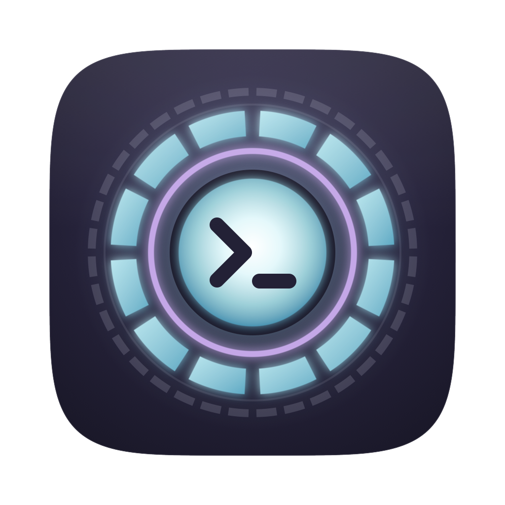

<p align="center"></p>

# Jarvis

A terminal built for running many coding agents across many repos from one window.

Claude Code, Codex, Pi on a local model, OpenCode, or a plain shell each run as their own unmodified CLI in a real terminal pane. Jarvis launches them, keeps them alive in tmux, groups them by repo in a sidebar, and lets you jump between them. Quitting or crashing Jarvis never stops an agent.

Around the terminal sits a cockpit: which agent needs you, what each one is doing (every tool call with its input and output), the files it touched, git changes, the docs it reads, your open PRs, its MCP connectors, and your plan usage with some fun numbers. Jarvis gets all of this by observing the agents (hooks and session logs), never by wrapping them in an SDK, so the agent's own TUI is what you type into.

Status: P0 (persistent sessions), the cockpit (attention, activity, files, PRs, connectors, usage) and R0 of the rich view are done. See [PLAN.md](PLAN.md) and [RICH-VIEW.md](RICH-VIEW.md) for what's next.

Needs macOS, Node 22.13+, pnpm, tmux (`brew install tmux`), and the agents you want to run. `gh` is optional, for the PRs tab.

## Install

```bash
git clone https://github.com/AyushGupta235/jarvis ~/jarvis && cd ~/jarvis && pnpm install:local
```

```bash
jarvis daemon install
```

`pnpm install:local` builds everything, installs `~/Applications/Jarvis.app`, links the `jarvis` CLI into `~/.local/bin`, restarts jarvisd and opens the app. `jarvis daemon install` (once) registers jarvisd as a launchd agent (`~/Library/LaunchAgents/dev.jarvis.jarvisd.plist`), so it starts at login and restarts if it crashes. It records the current Node path, so re-run it after switching Node versions. Without it, the app and the CLI start the daemon on demand.

### Running the latest build

The installed app is a snapshot of the code when you last built it. After pulling, or after changing Jarvis's code yourself, run:

```bash
cd ~/jarvis && pnpm install:local
```

It quits Jarvis if it's open, swaps in the new build, restarts jarvisd and reopens the app. Your sessions keep running throughout, because tmux and rich-session hosts outlive both the app and the daemon. While working on Jarvis itself, `pnpm dev` runs the app from source with hot reload (see Development).

## Using it

- **⌘T** opens the new-session picker: fuzzy-search your repos and worktrees (everything under `~/code` and `~`, most recently used first), pick an agent and model, and for Claude a view (Terminal or Rich), then press Enter.
- **⇧⌘T** starts another session in the current repo with the same agent and model.
- **⌘1…⌘9** jump to the Nth session in the sidebar. **⇧⌘[** and **⇧⌘]** cycle. **⌘P** fuzzy-jumps by name, repo or branch.
- **⌘W** hides a session from the sidebar (it keeps running; **⇧⌘H** shows hidden ones). **⇧⌘W** ends it.
- **⇧⌘R** or a double-click renames. Right-click a row for move, stop, revive, copy attach command, and reveal in Finder.
- **⌘D** / **⇧⌘D** split right / down (tmux panes), **⇧⌘ arrows** move focus, **⌘Z** zooms a pane.
- **⌘F** searches scrollback (tmux copy mode), **⇧⌘X** enters copy mode, **⌘K** clears.
- **⌘B** collapses the sidebar to a rail of session icons (drag its edge to resize; dragging it narrow does the same). **⌘= / ⌘- / ⌘0** change font size, **⌘↵** fills the screen, **⇧⌘↵** goes full screen.
- **View → Theme** has 20 colour themes: six Jarvis originals (Graphite, Night City, Sunset Drive, Phosphor, Matcha, Oxblood & Cream) plus classics like Rosé Pine, Catppuccin, Tokyo Night, Nord and GitHub. Each one colours the app, the terminal and code. **View → Interface Font** and **Terminal Font** pick fonts (Inter, Geist, JetBrains Mono, Geist Mono, Fira Code and IBM Plex Mono are bundled).
- **⇧↵** inserts a newline in Claude Code, and **⌥← / ⌥→** jump words, matching WezTerm.
- **Selecting and copying.**
  - In a shell, drag to select. The highlight stays until you click or type, **⌘C** copies it, and it is also copied as you let go. Double-click selects a word, triple-click a line.
  - In Claude Code and other full-screen programs, the drag goes to the program itself. Claude Code copies its selection as you let go.
  - Hold **⌥** while dragging to force a plain terminal selection anywhere.
  - Programs that copy through the terminal (tmux, vim over ssh) reach your clipboard too.

Sessions that end (process exit, reboot, `tmux kill-server`) stay in the sidebar as "ended". Select one and press Enter to revive it. Claude sessions resume their conversation with `claude --resume <id>`, because Jarvis pins each Claude session id up front with `--session-id`.

### The cockpit

The window has three parts: the session sidebar on the left, the terminal in the middle (with a file viewer that splits in beside it), and the navigator on the right (**⌘J**).

- **Sidebar.** Each session shows live state: working (with the tool it's running), **needs you** (gold, with the permission or question), done (unread turns are bold), or idle. A ring shows context-window use and a badge shows the branch's PR and CI status. The footer has your Claude 5-hour and weekly limits. **⇧⌘U** jumps to the next session waiting on you. You also get a macOS notification and a dock badge when a session you aren't looking at needs you or finishes.
- **Activity (⌥⌘1).** Every prompt, tool call, reply and subagent for the session, live. Click a row for the full input and output; edits show as diffs; subagent calls are indented under their agent. Filter to tools, errors, or prompts and replies.
- **Files (⌥⌘2).** The repo tree with git status, filtered to "changed" or "agent edited" in one click. **⌘O** fuzzy-opens any file. **⌘-click** a path in the terminal (including `path:line`) to open it.
- **Viewer.** Syntax-highlighted code (Rosé Pine), rendered markdown, images and diffs, reloading live as the agent edits. Click line numbers (shift-click for a range), then **@ L10-20** types `@path#L10-20` into the agent's prompt. **⌘\\** toggles the viewer.
- **Changes (⌥⌘3).** Uncommitted files with +/− counts; click for the diff.
- **Docs (⌥⌘4).** The markdown the agent works from: CLAUDE.md / AGENTS.md from global down to the current folder, repo docs, `.claude/agents`, commands and skills, your recent plans, and any .md the agent edited this session.
- **PRs (⌥⌘5).** Your open PRs, PRs waiting on your review, and your PRs merged in the last 30 days, across every `gh` account you're logged in to. Filter by open, mine, to review, ready, needs work (conflicts, failing checks, changes requested) or merged, or search by title, repo or branch. Each PR has one status label: ready to merge, checks failing, conflicts, changes requested, needs review, checks running, draft or merged. The merged view groups by day and totals your last 7 days. Refreshes every 2 minutes.
- **Connectors (⌥⌘6).** MCP servers available to the agent (user, project, repo, plugin, and claude.ai connectors), ranked by how often they were really called in the last 30 days. **Check health** runs the agent's own `mcp list`.
- **Pulse (⌥⌘7).** Plan limits with reset countdowns (Claude 5-hour and weekly; Codex windows), and the fun numbers: today's tokens and API-equivalent cost against your average, tool calls, lines written by agents, words of output, sessions and peak concurrency, cache hit rate and what it saved, your streak, a 30-day chart, the hour-of-day heatmap, model mix, top tools and top repos.
- **Thinking (⌥⌘8).** The agent's thinking for the session, grouped under the prompt it was answering, with search. Jarvis asks Claude to keep thinking summaries for the sessions it starts (it adds `showThinkingSummaries` to its own settings layer, not yours), so new sessions have readable thinking; older turns may show as "without text".
- **Web preview (⇧⌘B).** Open a dev server or any URL in the viewer pane, next to the session. It lists the servers listening on your Mac, with the ones started from this repo first. Device widths (1280, 1024, 768, 390), **Compare** for two pages side by side (say, local against staging), reload on save, devtools. ⌘-click a `localhost` link in the terminal or a reply to open it there.
- **Quote-reply.** Drag over something the agent said and click **❝ Quote in reply** (or press **⌘'**). It lands in the prompt as a `>` quote, ready for you to type underneath.

### Rich view (early)

Claude sessions can also run in a rich view: pick **Rich (SDK)** under View in ⌘T, or run `jarvis new --rich`. The session runs through the Agent SDK in a small host process, and Jarvis draws it instead of showing Claude Code's TUI. It is on your Claude plan, and it uses your CLAUDE.md, hooks, skills and MCP servers like the CLI does.

- **Replies render as readable markdown**: tables (numbers right-aligned), code blocks with a language label, copy button and highlighting in your theme, callouts, task lists, and file paths that open in the viewer. Hover a reply for **Copy markdown** and **Raw**, to take the exact markdown somewhere else.
- **Every slash command works.** Type **/** for the list. Most run through Claude Code as usual (`/context`, `/compact`, `/clear`, skills, your own commands). Jarvis does the interactive ones itself: `/resume` lists the conversations in this folder, `/model`, `/effort` and `/permissions` open pickers, plus `/status`, `/copy`, `/export` (to ~/Downloads), `/memory` and `/exit`. Commands that need Claude Code's own screen (`/login`, `/theme`, `/rewind`, `/plugin`, `/doctor` and so on) reopen the same conversation in a terminal with the command typed; **rich view ↗** in the title bar brings it back.
- **Work stays out of the way.** Tool calls and thinking sit in a dim panel between Claude's messages; several steps fold into one row ("6 steps · Read ×3 · Bash ×2") that shows the latest step while it runs and opens to each call, with its input and output a click further. Commands drop their `cd …&&` prefix and show repo paths relative.
- Allow and Deny for permission prompts, and a composer: ↵ sends, ⇧↵ adds a newline, esc interrupts, ⌘' quotes the selection.
- **Thinking, three ways** (the switch under the composer, View → Thinking, or ⌥⌘T to cycle): **Focus** hides it, **Normal** folds each stretch of thinking between Claude's messages into one row you can open, and **Detailed** shows it all inline as readable paragraphs with compact tool rows.

Rich sessions persist the way terminal ones do. They survive quitting Jarvis and restarting jarvisd, and if their host dies, revive resumes the conversation. The conversation is a normal Claude transcript, so `claude --resume <id>` opens it in a terminal too.

### From any terminal

```bash
jarvis ls
```

```bash
jarvis new ~/code/api-server --agent claude --model opus
```

```bash
jarvis attach api-server
```

`jarvis send <session> <text>` types into a session and `jarvis capture <session>` prints its screen, which lets agents and scripts drive Jarvis. `jarvis help` lists everything.

## Agents

Built-in launch recipes cover claude, codex, pi, hermes, opencode, gemini, aider and shell. The picker greys out any whose command is not on your login shell's PATH. `jarvis agents` shows what was detected.

Add or override agents in `~/.jarvis/agents.json`, matched by `id`. Placeholders are `{model}`, `{sessionId}` and `{name}`. An argument group whose placeholder is empty is dropped.

```json
[
  {
    "id": "pi-local",
    "label": "Pi (local)",
    "command": "pi",
    "args": ["--provider", "ollama"],
    "modelArgs": ["--model", "{model}"],
    "glyph": "π"
  },
  {
    "id": "codex",
    "label": "Codex",
    "command": "codex",
    "args": ["--profile", "fast"],
    "modelArgs": ["--model", "{model}"]
  }
]
```

Add `"models": [{ "value": null, "label": "Default" }, { "value": "<model id>", "label": "…" }]` to get preset buttons in the picker instead of a free-text model field. Other fields: `sessionIdArgs` pins the agent's own session id at launch, `resumeArgs` is used when reviving, `nameArgs` sets a display name, and `integration` (`"claude"` or `"codex"`) turns on the cockpit observer for wrappers of those CLIs. See `AgentDef` in [packages/protocol/src/index.ts](packages/protocol/src/index.ts).

## How it works

```
Jarvis.app (Electron)            jarvis CLI
  sidebar, picker, xterm.js         |
  PTY per visible terminal          |
        |  unix socket (WebSocket + JSON-RPC)
        v
jarvisd (launchd)  ->  tmux -L jarvis  ->  zsh -l -i -c '<agent> …; exec zsh -l'
  registry: ~/.jarvis/jarvis.db (node:sqlite)
```

- **tmux owns every process.** Jarvis runs its own tmux server (`-L jarvis`) with a config generated from your `~/.tmux.conf`. Your prefix, vi copy mode and pbcopy bindings carry over. The tpm, resurrect and continuum lines are removed so this server never restores or overwrites your default-socket snapshots.
- **Agents start through an interactive login shell**, so PATH and rc files match a normal terminal. When the agent exits you drop back into a shell in the same pane.
- **Only visible terminals are attached.** Each view is an xterm.js instance running `tmux attach`. The 5 most recent stay warm and the rest are detached, so app memory stays flat however many agents run. Scrollback lives in tmux (50,000 lines).
- **The daemon scrubs its environment** (`CLAUDECODE`, `CLAUDE_*`, `TMUX`, `ELECTRON_*` and similar) before starting tmux, so agents never think they are nested in another agent.
- Sessions on your default tmux socket appear in a "tmux (default socket)" group and can be attached too.

**How the observers work.**

- **Claude Code:** for sessions it launches, Jarvis adds `--settings ~/.jarvis/claude-settings.json`. That file adds async hooks (`~/.jarvis/bin/jarvis-hook`, a tiny `curl` to the daemon socket) and a status line tap that forwards the status JSON, then runs your own status line command unchanged. Your `~/.claude/settings.json` is never edited, and sessions you start outside Jarvis are untouched.
- **Codex:** Jarvis follows the session's rollout log in `~/.codex/sessions`. It's verified against the logs the Codex desktop app writes, but not yet against the CLI.
- **Usage:** Pulse reads your Claude transcripts and Codex rollouts locally into SQLite. Dollar figures use LiteLLM's public price table at API list price, so treat them as an equivalent, not your bill.
- **Connectors:** only server names, the command name and URL hosts are read from your MCP configs. Env vars and headers are never read.

State lives in `~/.jarvis`: `jarvis.db`, the generated tmux configs, `agents.json`, and `logs/jarvisd.log`.

Measured on 2026-10-21 with 20 sessions open: the app's processes total about 420 MB RSS, unchanged between launch and visiting every session. `jarvisd` uses about 45 MB.

## Troubleshooting

- **A red banner says session state may be stale.** jarvisd can't run tmux, so what you see is frozen at the last good poll. If it says macOS is out of open files (ENFILE), another app is holding too many files: `sysctl kern.num_files kern.maxfiles` shows how close you are. Virtual machines that share folders can hold tens of thousands. Quit the culprit and the banner clears on its own.
- **The app looks older than the code.** The installed app only changes when you rebuild it. Run `pnpm install:local`.
- **Logs.** `jarvis daemon logs` for jarvisd, and `~/.jarvis/logs/rich-<id>.log` for a rich session's host.

## FAQ

**Does it use the Claude or Codex SDKs?** Terminal sessions don't: each agent runs as its own CLI, exactly as if you'd typed `claude` or `codex`, and swapping harness is picking a different agent in ⌘T or adding one to `agents.json`. The optional rich view for Claude runs on the Agent SDK (see above).

**Do sessions survive closing the laptop?** Sleep, yes: tmux and every agent are suspended with the machine and carry on when it wakes. A request that was in flight may need a retry, and Claude Code retries API errors itself. A shutdown or restart ends the processes. The sessions stay in the sidebar as "ended", and Enter revives them; Claude picks up its conversation with `claude --resume`. Nothing keeps working while the lid is closed. For that, the agents have to run on a machine that stays on, which is on the roadmap.

## Development

```bash
pnpm dev
```

`pnpm dev` runs the app with hot reload against the daemon bundle. Other scripts:

| Command | What it does |
|---|---|
| `pnpm build` | Bundle daemon, CLI and app |
| `pnpm typecheck` | Type-check all packages |
| `pnpm test` | Unit tests (vitest) |
| `pnpm e2e` | Acceptance test, below |
| `pnpm e2e:rich` | Rich view: persistence (23 checks) and slash commands plus markdown (18 checks). A few Haiku calls |
| `pnpm e2e:ui` | Web preview, sidebar, side panel and thinking (9 checks, one Sonnet call), then every theme and font (5 checks) |
| `pnpm package` | Build `apps/desktop/release/mac-arm64/Jarvis.app` |
| `pnpm install:local` | Build, install to `~/Applications`, restart jarvisd and reopen the app |

The acceptance test drives the real app through Playwright in throwaway git repos, with an isolated `JARVIS_HOME`, tmux socket and Electron profile. It starts 5 Claude sessions (Haiku) plus a shell and a user-defined agent across 3 repos. It sends prompts, quits Jarvis, relaunches it, and checks that every session reattaches with the same process, screen, conversation and scrollback. It then kills a session's tmux outright and checks that revive resumes the conversation. Pass `--packaged` to test the built `.app`, or `--claude N` to change the session count. It costs a few Haiku calls.

Layout:

```
packages/protocol   shared types (browser-safe) + node-only paths (@jarvis/protocol/node)
packages/daemon     jarvisd: registry, tmux controller, agent registry, socket API
apps/cli            jarvis command
apps/desktop        Electron main (daemon client, PTYs, menu) + React renderer
e2e                 Playwright acceptance test
```
